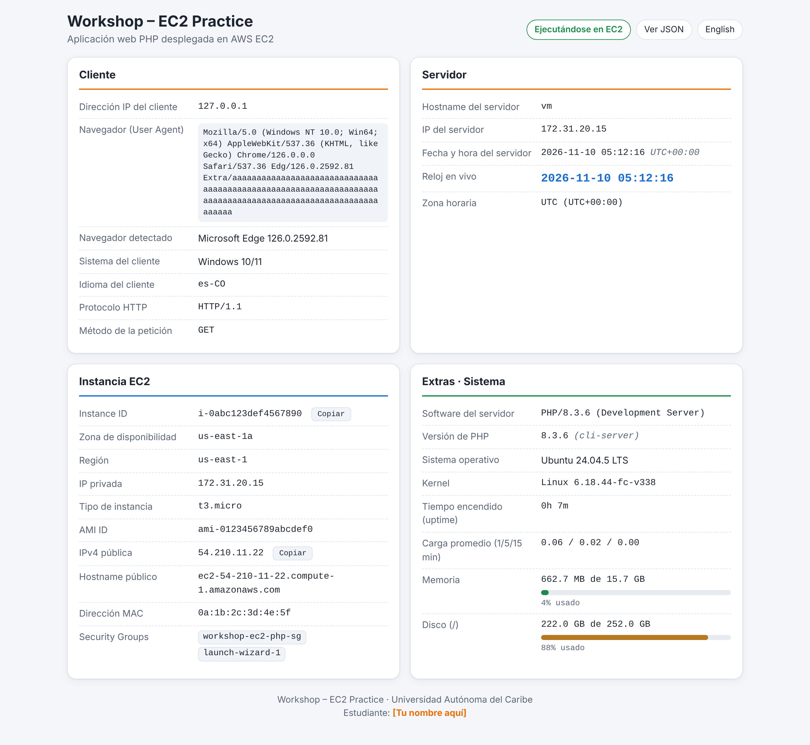

# Workshop – EC2 Practice: aplicación web PHP en AWS EC2

Kit listo para el laboratorio **"Deploying a Web Application on AWS EC2 with PHP"** (Universidad Autónoma del Caribe).
Incluye la página PHP, scripts de instalación/despliegue y esta guía.

> **Antes de grabar:** abre `web/index.php` y cambia la constante `STUDENT_NAME` (línea ~13) de `[Tu nombre aquí]` por tu nombre.



## Contenido

```
taller-php/
├── README.md
├── web/
│   ├── index.php          # La página (cliente, servidor, instancia EC2, extras)
│   └── health.php         # Endpoint JSON {"status":"ok","time":"..."}
├── scripts/
│   ├── install.sh         # Se ejecuta EN la instancia: instala Apache+PHP y publica la página
│   ├── user-data.sh       # User data para Amazon Linux 2023 (GENERADO, no editar a mano)
│   ├── build-user-data.sh # Regenera user-data.sh a partir de web/*.php
│   ├── deploy.sh          # Despliegue automático con AWS CLI v2 (CloudShell)
│   └── cleanup.sh         # Borra todo lo creado por deploy.sh
└── docs/                  # Capturas de pantalla
```

---

## Ruta A – Manual (recomendada para el video)

### Parte 1 – Crear la instancia EC2 (consola)

1. Consola de AWS → **EC2** → **Launch instance**.
2. **Name:** `workshop-ec2-php`.
3. **AMI:** *Amazon Linux 2023* (Free tier eligible).
4. **Instance type:** `t3.micro` (o `t2.micro` si tu región/cuenta lo marca como free tier).
5. **Key pair:** *Create new key pair* → nombre `workshop-ec2-key`, tipo RSA, formato `.pem`. Se descarga el archivo: guárdalo.
6. **Network settings** → *Create security group* con estas reglas de entrada:
   - **SSH** (TCP 22) – Source: *My IP* (más seguro) o `0.0.0.0/0`.
   - **HTTP** (TCP 80) – Source: `0.0.0.0/0`.
   - Asegúrate de que **Auto-assign public IP** esté en *Enable*.
7. **Launch instance**.
8. En *Instances*, espera a que **Instance state = Running** y **Status check = 2/2 checks passed**.
9. Selecciona la instancia y copia la **Public IPv4 address**.

### Conexión por SSH

Desde tu equipo (Linux/macOS/PowerShell con OpenSSH):

```bash
chmod 400 workshop-ec2-key.pem        # en Windows no es necesario
ssh -i workshop-ec2-key.pem ec2-user@<IP-PUBLICA>
```

(Alternativas permitidas: *EC2 Instance Connect* desde la consola, o AWS CloudShell.)

### Parte 2 – Instalar Apache y PHP (escritos a mano)

```bash
sudo dnf update -y                        # opcional
sudo dnf install -y httpd php php-fpm     # (basta "httpd php"; php-fpm se instala como dependencia)
sudo systemctl enable --now httpd         # inicia Apache y lo habilita al arranque
sudo systemctl enable --now php-fpm
systemctl status httpd                    # debe decir: active (running)
systemctl is-enabled httpd                # debe decir: enabled
php -v
```

Verifica en el navegador: `http://<IP-PUBLICA>/` (usa **http://**, no https). Verás la página de prueba de Apache.

### Parte 3 – Publicar la página PHP

Primero lleva los archivos a la instancia (elige una opción):

- **scp** (desde tu equipo, dentro de esta carpeta):
  ```bash
  scp -i workshop-ec2-key.pem web/index.php web/health.php ec2-user@<IP-PUBLICA>:~
  ```
- **nano + pegar:** en la instancia `nano index.php`, pega el contenido, `Ctrl+O`, `Enter`, `Ctrl+X`. Repite con `health.php`.
- **git clone:** si subes este kit a un repositorio: `sudo dnf install -y git && git clone https://github.com/Camilopr09/taller-php.git`.

Luego, en la instancia:

```bash
sudo cp index.php health.php /var/www/html/
sudo chown apache:apache /var/www/html/*.php
sudo systemctl restart httpd php-fpm
curl http://localhost/health.php
```

Abre `http://<IP-PUBLICA>/` en el navegador.

> **Atajo:** con el repositorio/carpeta completa en la instancia, `bash scripts/install.sh` hace toda la Parte 2 y 3
> (instala, habilita servicios, copia archivos, ajusta permisos y verifica), mostrando cada paso numerado.

---

## Ruta B – Automática

### B1. `deploy.sh` (AWS CloudShell o AWS CLI v2 local)

En CloudShell sube esta carpeta (Actions → Upload file, o `git clone`) y ejecuta:

```bash
bash scripts/deploy.sh
```

Variables opcionales (con sus valores por defecto):

```bash
AWS_REGION=us-east-1 INSTANCE_TYPE=t3.micro NAME=workshop-ec2-php KEY_NAME=workshop-ec2-key bash scripts/deploy.sh
```

Crea el key pair (guarda `workshop-ec2-key.pem`), el Security Group (SSH solo desde tu IP, HTTP abierto), lanza la instancia con IMDSv2 obligatorio y
`user-data.sh`, espera a que esté *running*, y comprueba `http://IP/health.php`. Al final imprime la URL y el comando `ssh`.
Todo lleva la etiqueta `Project=workshop-ec2-php`.

### B2. Pegar `user-data.sh` en la consola

En el asistente *Launch instance* → **Advanced details** → **User data**, pega el contenido de `scripts/user-data.sh`
(~13 KB; el límite es 16 KB). Al primer arranque instala Apache + PHP, habilita los servicios y publica la página, sin necesidad de SSH.
Espera 1–2 minutos tras el estado *Running*.

Si cambias `web/*.php`, regenera el user data: `bash scripts/build-user-data.sh`.

---

## Checklist de requisitos

| Requisito del laboratorio | Dónde se cumple |
|---|---|
| Crear instancia EC2 | Ruta A, Parte 1 (o `deploy.sh`) |
| Security Group con SSH (22) y HTTP (80) | Parte 1, paso 6 / `deploy.sh` paso 4 |
| Verificar estado *Running* y obtener IP pública | Parte 1, pasos 8–9 / `deploy.sh` pasos 7–8 |
| Instalar Apache y PHP | Parte 2 / `install.sh` / `user-data.sh` |
| Iniciar y habilitar el servicio al arranque | `systemctl enable --now httpd` + `is-enabled` |
| Verificar desde el navegador | `http://<IP-PUBLICA>/` |
| IP del cliente | Tarjeta **Cliente** → "Dirección IP del cliente" |
| Navegador (User Agent) | Tarjeta **Cliente** → "Navegador (User Agent)" |
| Hostname del servidor | Tarjeta **Servidor** |
| IP del servidor | Tarjeta **Servidor** |
| Fecha y hora actual del servidor | Tarjeta **Servidor** (con zona horaria y offset UTC) |
| Instance ID, Zona de disponibilidad, Región, IP privada | Tarjeta **Instancia EC2** (metadata IMDSv2) |
| Acceso admin por SSH / CloudShell / CLI | Ruta A (SSH) y Ruta B (CloudShell + AWS CLI) |

## Extras (valor agregado)

- Metadata vía **IMDSv2** (token), con caché de 60 s, timeouts cortos y degradación elegante fuera de EC2.
- Tipo de instancia, AMI ID, IPv4 pública, hostname público, MAC y Security Groups.
- Navegador y sistema operativo interpretados, idioma, protocolo HTTP y método; `X-Forwarded-For` como dato informativo.
- Software del servidor, versión de PHP, SO/kernel, uptime, carga promedio, memoria y disco con barras de progreso.
- Reloj del servidor en vivo (JavaScript) y botones **Copiar** para Instance ID e IP pública.
- Salida **JSON** (`/?format=json`) y selector de idioma **es/en** (`/?lang=en`).
- Endpoint de salud `/health.php`.
- Diseño responsivo con modo oscuro automático, sin dependencias externas.
- Seguridad: escape de toda salida, listas blancas de parámetros, `nosniff`, `no-store`, IMDSv2 obligatorio en `deploy.sh`, SSH restringido a tu IP.
- Automatización: `install.sh`, `user-data.sh` (generado), `deploy.sh` y `cleanup.sh`.

## Guion sugerido para el video (5–8 min)

1. Presentación: nombre, materia, objetivo (10 s).
2. Consola EC2 → Launch instance: nombre, AMI AL2023, tipo, key pair, Security Group con 22 y 80 (mostrar las reglas).
3. Instancia en **Running**; mostrar Instance ID e IP pública.
4. Conexión por SSH (`ssh -i ... ec2-user@IP`).
5. `sudo dnf install -y httpd php`, `sudo systemctl enable --now httpd`, `systemctl status httpd`, `systemctl is-enabled httpd`.
6. Navegador: página de prueba de Apache.
7. Copiar `index.php` (scp o nano), `sudo cp ... /var/www/html/`, recargar el navegador.
8. Recorrer la página: Cliente, Servidor, Instancia EC2, Extras; cambiar a inglés; mostrar `?format=json`; comparar Instance ID/IP con la consola.
9. **Prueba de arranque automático:** en la consola *Instance state → Reboot instance*; esperar ~1 min; recargar la página (sigue funcionando sin tocar nada) y mostrar el uptime reiniciado.
10. Cierre: terminar la instancia (o `cleanup.sh`) y mencionar los extras.

## Solución de problemas

| Síntoma | Causa / solución |
|---|---|
| La página no carga (timeout) | El Security Group no tiene el puerto **80** abierto a `0.0.0.0/0`; o usas `https://` (usa `http://`); o la instancia no tiene IP pública. |
| El navegador muestra o descarga el código PHP | PHP no está instalado o no se reinició: `sudo dnf install -y php php-fpm && sudo systemctl restart httpd php-fpm`. |
| Aparece la página de prueba de Apache en vez de la tuya | No copiaste `index.php` a `/var/www/html/`, o falta `php-fpm` activo. |
| Metadata de EC2 "No disponible" | No estás en EC2, o el IMDS está deshabilitado / hop limit insuficiente (`aws ec2 modify-instance-metadata-options --instance-id ID --http-endpoint enabled --http-put-response-hop-limit 2`). La caché dura 60 s. |
| `Permission denied (publickey)` en SSH | Usuario correcto `ec2-user` (Ubuntu: `ubuntu`) y `chmod 400` a la llave. |
| La IP pública cambió | Al **detener/iniciar** la instancia cambia la IP pública (con *Reboot* no). Copia la nueva IP, o usa una Elastic IP. |
| `deploy.sh`: el user data no se ejecutó | Mira `/var/log/workshop-user-data.log` y `/var/log/cloud-init-output.log` en la instancia. |

## Costos y limpieza

Una instancia encendida consume horas de free tier (o genera costo). **Al terminar**, termina la instancia en la consola
(*Instance state → Terminate*) o ejecuta `bash scripts/cleanup.sh` (pide confirmación; `--yes` para omitirla).
Elimina también la llave local: `rm -f workshop-ec2-key.pem`.

## Notas

- Los scripts de AWS (`deploy.sh`, `cleanup.sh`) están escritos para AWS CLI v2 pero no se probaron contra una cuenta real: revísalos antes de usarlos.
- Para probar la página localmente: `php -S 127.0.0.1:8080 -t web` (mostrará "No disponible" en los datos de EC2).
